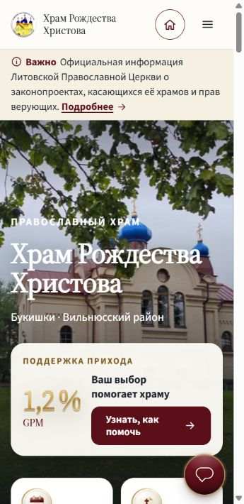
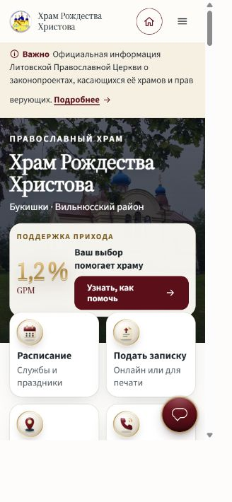
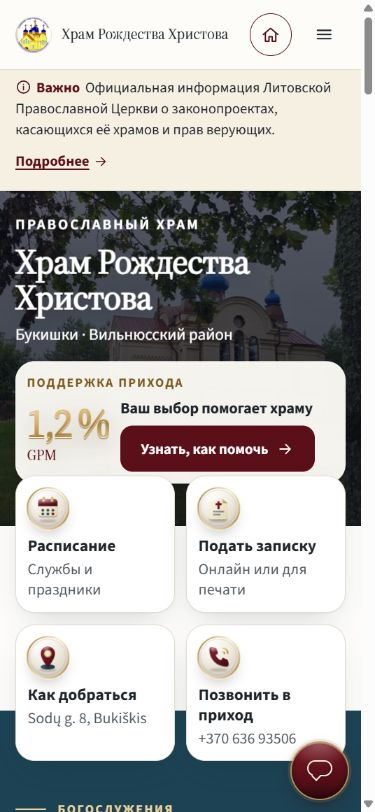
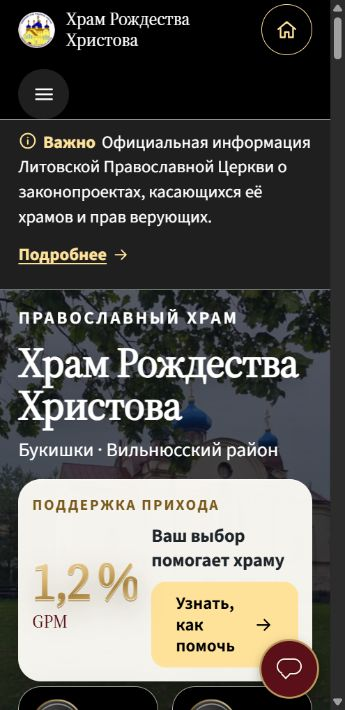
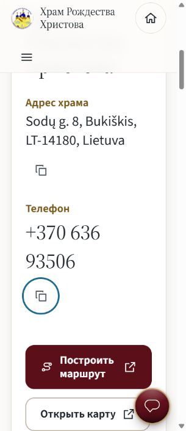

# Mobile usability review — 2026-11-05

Source baseline: `9d7301a239d25702a8d11bf431d393c3d19441b0`.
Checked the locally built site in Chromium using CSS viewport overrides.

## Changes

- The phone hero follows its content height rather than occupying 78% of the viewport before the header and announcement are counted. GPM stays in the hero. Phone-only spacing, title sizing and photo shading keep the first quick-link row readable and visible.
- Standalone announcement, calendar, footer and contact controls have a minimum 44 px height on phone/touch layouts; copy buttons are 44 × 44 px.
- Quick-link descriptions and contact address/phone labels use 16 px, scaling with the reading preference.
- Contact values and copy controls wrap on narrow screens instead of widening the page.
- Desktop hero styling, published content, links, AI configuration and service data are unchanged.

## Browser checks

First quick-link row bottom, CSS pixels from the top of the page, default reading settings:

| Language | 360 × 740 | 390 × 844 |
| --- | ---: | ---: |
| RU | 667 | 637 |
| LT | 667 | 658 |
| DE | 667 | 658 |
| EN | 637 | 637 |
| PL | 680 | 637 |
| UK | 667 | 624 |

No page-level horizontal overflow in these 12 cases. Before the change the RU first row ended at 872 px on 360 × 740; after the change it ends at 667 px. The complete second row also fits on the tested RU 390 × 844 view.

- Checked all six home and contact translations at 360 px with large text, dark theme and high contrast: no horizontal overflow; contact targets scale to approximately 52.8 px and labels to 19.2 px.
- At 320 px with large text, the RU contact card also stays within the viewport; the phone and copy button may use separate lines.
- Checked desktop RU at 1440 × 900: four-column quick links and the original desktop hero layout remain in place, without horizontal overflow.
- Followed the home schedule link and opened a church-day disclosure on the schedule page; the disclosure target measures 44 px.
- `npm run check`: 129 tests passed. `git diff --check`: passed.

Large text intentionally grows the document: the first quick-link row is not guaranteed to fit entirely in the first viewport in that mode. Nothing is clipped to force a fit. These are Chromium viewport checks, not physical-device, iOS Safari or screen-reader tests. No live API messages or parish form submissions were sent.

## Screenshots

| Before, RU 360 × 740 | After, RU 360 × 740 |
| --- | --- |
|  |  |

